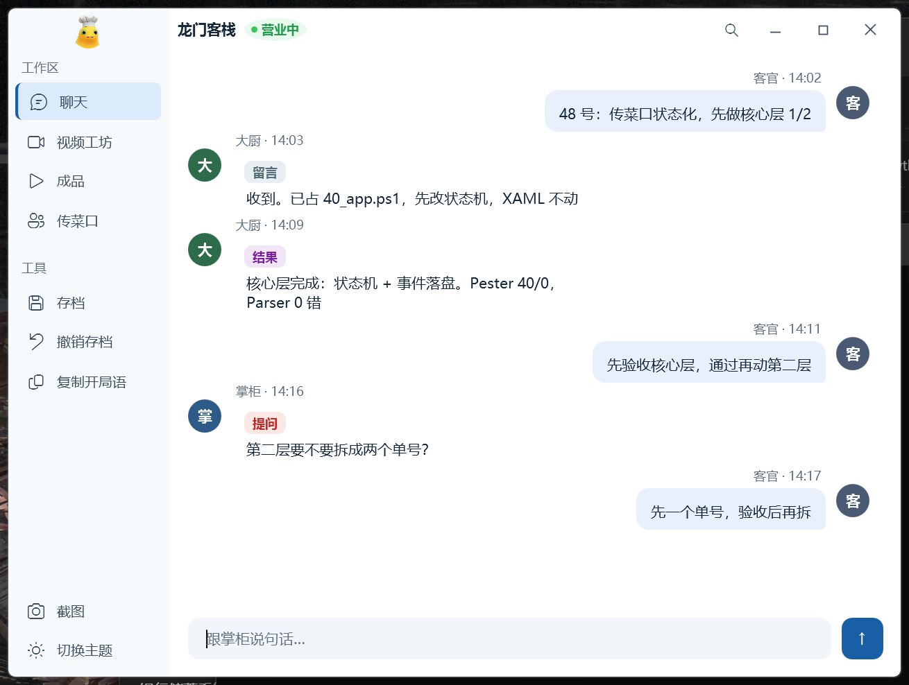
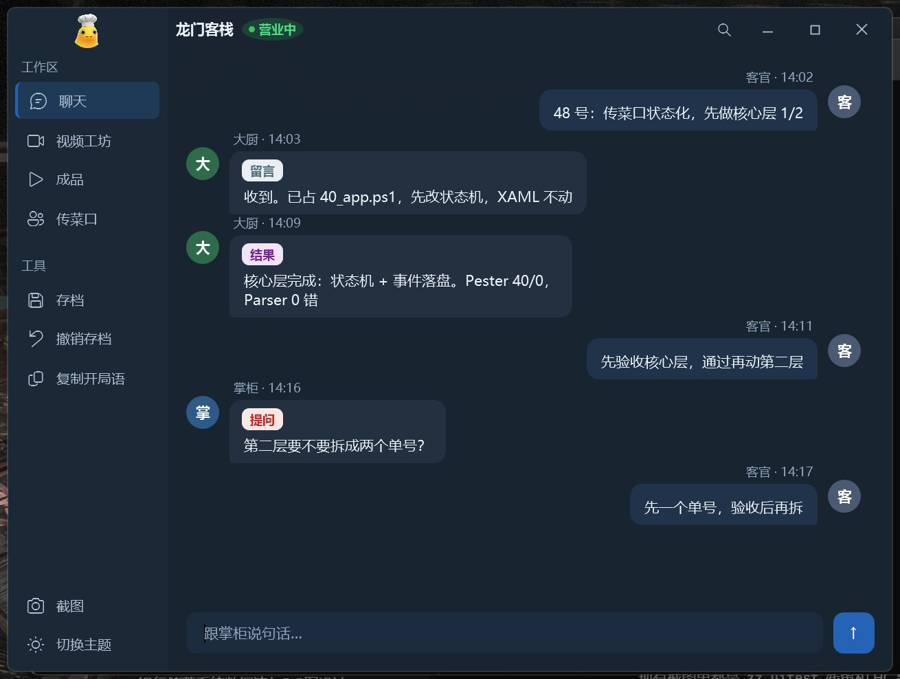
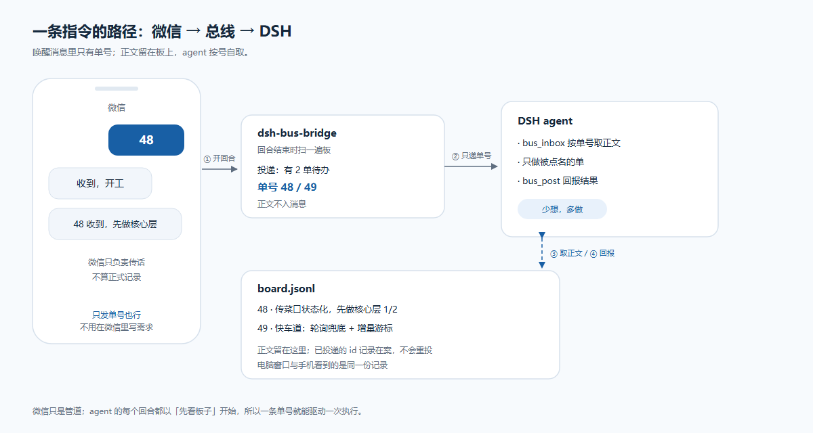

# Longmen Kezhan · 龙门客栈

> A local-first desktop client where one human and two AI assistants share a single timeline.
> PowerShell 5.1 + WPF. Nothing to install. Ships as one 177 KB script.

[简体中文](README.md) | **English**

This is not a general-purpose chat app. It exists for one topology: me plus assistant A plus assistant B working at the same time. Messages, actions, and file ownership have to be visible in one place, otherwise the three of us step on each other. On the desktop it is a window; on the phone it is WeChat — send an order number and the job reaches DSH.

| Light | Dark |
| --- | --- |
|  |  |

## Download

Windows 10/11, no installation: [latest release](https://github.com/1968630284/longmen-kezhan/releases/latest) (~141 KB, unzip and double-click `launch_app.vbs`).

## Phone control: WeChat → bus → DSH

The original use case is away from the desk: you send one line in WeChat, and the DSH agent picks the order up from the shared board.



*Schematic: UI elements are illustrative, not a real chat screenshot.*

- **The wake message carries no body.** The bridge only says "2 orders pending, ids 48 / 49"; the agent fetches the bodies from `board.jsonl` itself. Context stays short, so it acts instead of over-thinking.
- **The order number is the command.** Every message has an `id`; you name one, the agent does that one.
- **Delivery is auditable and never repeated.** Delivered ids are recorded in the bus state file and mirrored to `activity.jsonl`; a bridge failure only logs, never blocks the agent loop.
- **WeChat is just a pipe.** The record of truth is `board.jsonl`; the channel is bound to the owner's WeChat identity so attribution stays intact.

Both DSH plugins live in this repo: [dsh-bus-bridge](dsh-bus-bridge/index.js) (bus bridge with `bus_inbox` / `bus_post` and soft wake) and the WeChat plugin installed on the DSH side (`dsh-plugin-weixin`).

## Highlights

Every item maps to code in this repo; the numbers were measured on the author's machine.

| Highlight | How | Result |
| --- | --- | --- |
| **Reproducible build** | Five source slices under `src/` are byte-concatenated into a single `.ps1`; no re-encoding, BOM added once | Stable SHA256; `tools/check_source_sync.ps1` catches source/artifact drift |
| **Incremental JSONL parsing** | Read only from the last byte offset, keep half lines for the next round; 9 sampled anchors detect in-place rewrites | Appending a message is O(new lines) instead of O(N) |
| **Measurement-driven performance** | Frame-pacing probe and boot phase timing first, then optimize | Theme switch 726ms → 412ms; 238 brush allocations replaced by a shared cache; 288 closures collapsed into script-level singletons |
| **P/Invoke compile cache** | Three inline C# blocks cost 38% of time-to-window (368–402ms); cache the DLL by source hash, fall back to compiling | Faster warm starts |
| **Theme tokens + contrast** | One semantic palette for light/dark; body text ≥4.5:1, component strokes ≥3:1 | 24/24 color pairs pass WCAG relative-luminance checks |
| **Portable delivery** | `$AppRoot` (script directory) replaces 36 hard-coded paths | Green package runs from any folder; data stays inside it |
| **One-command checks** | BOM + parser + Pester + optional static analysis | `tools/verify_baseline.ps1` prints GREEN/RED; currently 40/40 |

## Build and run

Windows 10/11 with the built-in PowerShell 5.1. No Node, Python, or SDK required.

```powershell
# single-file artifact (default: ..\xiaozhu_live.ps1 next to the repo)
powershell -NoProfile -ExecutionPolicy Bypass -File tools\build.ps1

# portable package (dist\ and a zip)
powershell -NoProfile -ExecutionPolicy Bypass -File tools\package.ps1
```

Run by double-clicking `launch_app.vbs` inside the package (silent launch, no console), or `powershell -STA -File xiaozhu_live.ps1`.

## Checks

```powershell
powershell -File tools\verify_baseline.ps1     # BOM / parser / Pester
powershell -File tools\check_source_sync.ps1   # source vs artifact
```

Red means stop editing — the gate exists because several agents take turns on the same files. CI runs the same steps on `windows-latest`.

## Layout

```
src/            five source slices: header / data / UI helpers / XAML / main logic (~3.4k lines)
tools/          build.ps1 · package.ps1 · verify_baseline.ps1 · check_source_sync.ps1
tests/          Pester specs (40 cases)
bus/            append-only JSONL collaboration bus
dsh-bus-bridge/ DSH plugin: mirrors turns to the bus, exposes bus_inbox / bus_post, soft wake
reports/        53 proposals, deliveries and baselines (acceptance matrices and measurements)
AGENTS.md       collaboration rules for humans and agents
ledger.md       delivery ledger, one row per order
```

## Trade-offs

- **Not a general product**: built for one human plus two assistants, so there are no accounts, no server, no multi-tenancy.
- **Single file over modules at delivery**: the sources are split, the artifact is one `.ps1` — shortcuts, silent launch and one-file rollback depend on it.
- **No rewrite into another language**: startup and rendering are not free, but the bus, archive and bridge assets live on this implementation; gradual replacement beats a rewrite.
- **Files as the database**: messages, state and the bus are local JSON/JSONL. Deleting the folder uninstalls everything.

## Known limits

- UI and docs are mostly Chinese; code comments are mixed.
- The video studio needs an external ffmpeg and is not in the repo.
- The archive tool depends on the author's local dev assets; the portable package shows a notice instead.
- No code signing, so SmartScreen may warn on first run.

## License

MIT
