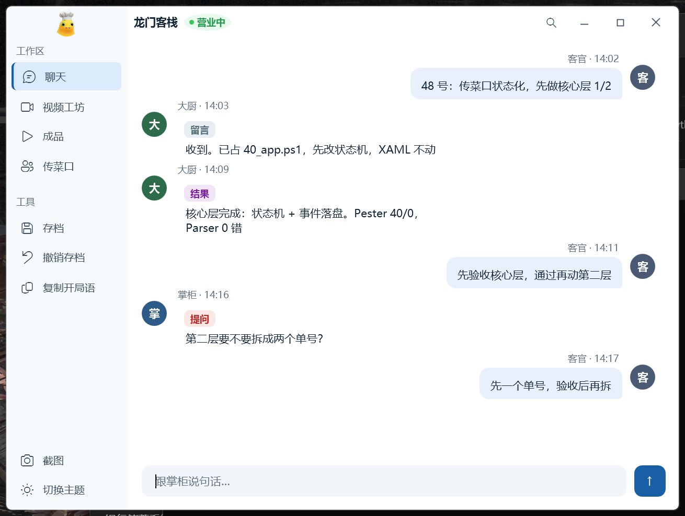
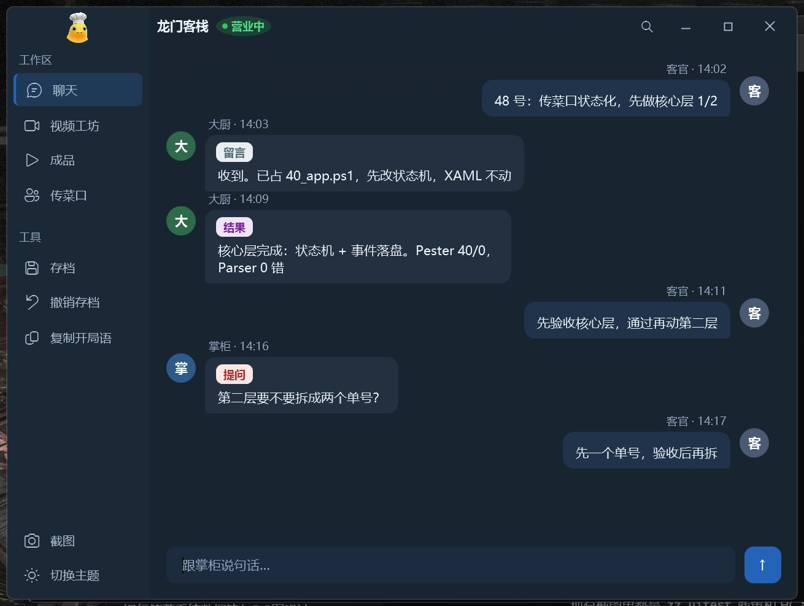
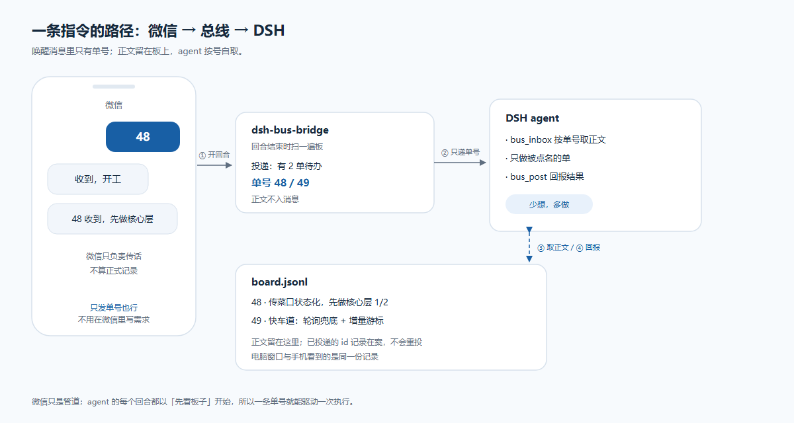

# 龙门客栈 · Longmen Kezhan

[](https://github.com/1968630284/longmen-kezhan/actions/workflows/ci.yml)
[](https://github.com/1968630284/longmen-kezhan/releases/latest)
[](LICENSE)

[English](README.en.md) | **简体中文**

> 一个人 + 两个 AI 助手，共用同一条时间线的本地协作客户端。
> PowerShell 5.1 + WPF，零运行时依赖，单文件 177 KB 交付。

界面标题「龙门客栈」。它不是通用聊天软件，而是为「我 + 助手 A + 助手 B 同时干活」这一个场景写的：消息、动作、文件占用必须在一处可见，否则三个人会互相踩。电脑上是一个窗口，手机上是一条微信——发个单号，活就派给 DSH 了。

| 浅色 | 深色 |
| --- | --- |
|  |  |

## 下载

Windows 10/11 免安装：[最新绿色包](https://github.com/1968630284/longmen-kezhan/releases/latest)（约 140 KB，解压后双击 `launch_app.vbs`，不弹控制台）。

## 三个界面

| 视图 | 作用 |
| --- | --- |
| **聊天** | 人、助手 A、助手 B 的消息按时间合并成一条流；连续消息自动分组、按天分隔；支持搜索、截图、深浅主题 |
| **传菜口** | 三个页签：留言板、动作日志、文件占用。助手改文件前先 `claim`，冲突直接在界面上暴露，不用靠喊话 |
| **视频工坊** | 本地渲染任务队列、成品预览（可选组件，需要 ffmpeg，不随包分发） |

## 手机遥控：微信 → 总线 → DSH

这套东西最初的用法不在电脑前：人在手机上发一句话，云端/本地的 DSH agent 就去板子上取单干活。



*示意图：界面元素为示意，不是真实聊天截图。*

关键设计：

- **唤醒消息里没有正文**。桥只递「有几单、单号是多少」，agent 自己按号去 `board.jsonl` 取原文。上下文不会被几千字的需求淹没，也就不需要为了一句指令先想很久——它只需要做事。
- **编号就是指令**。板上每条消息带 `id`，每张单带单号；人在手机上报一个号，agent 只取那一件，不会顺手把别的也做了。
- **投递可审计、不重投**。已投递的单号记在总线状态文件里，每次投递都写进 `activity.jsonl`；桥挂了只打日志，不会阻塞 agent 回合。
- **微信只是管道**。正式记录以 `board.jsonl` 为准；这条线绑的是本人的微信身份，助手不能冒充发言，否则归因就断了。

两个 DSH 插件都在仓库里：[dsh-bus-bridge](dsh-bus-bridge/index.js)（总线桥，含 `bus_inbox` / `bus_post` 工具与软唤醒）、微信插件在 DSH 侧安装（`dsh-plugin-weixin`），扫码登录后双向可用。

## 技术看点

每一条都能在源码里找到对应实现，数字都是本机实测。

| 看点 | 做法 | 结果 |
| --- | --- | --- |
| **可复现构建** | 源码按职责拆 5 片（`src/`），按字节拼接成单个 `.ps1`，不重新编码、BOM 只加一次 | 产物 SHA256 稳定可复算，`tools/check_source_sync.ps1` 守卫「源 / 产物分叉」 |
| **增量解析 JSONL** | 只从上次字节偏移读新增内容，半行留到下一轮；用 9 个采样锚点识别「文件被就地重写」 | 消息追加从 O(N) 全量重解析降到 O(新增行) |
| **测量驱动的性能优化** | 先做帧率探针与启动分段计时，再动手 | 主题切换 726ms → 412ms；238 处画刷调用改共享缓存；288 个闭包/委托收敛为脚本级单例 |
| **P/Invoke 编译缓存** | 三段 C# 现场 `Add-Type` 占启动 0→窗口解析耗时的 38%（368–402ms），改为按源码哈希落盘 DLL，损坏自动回退 | 首次之后直接加载，启动更快 |
| **主题令牌 + 对比度验算** | 浅/深两套语义色板是唯一颜色数据源，正文 ≥4.5:1、组件描边 ≥3:1 | 24/24 组配色通过 WCAG 相对亮度验算 |
| **可移植交付** | 程序根目录由 `$AppRoot`（脚本所在目录）派生，36 处路径不再写死盘符 | 绿色包解压到任意目录即可运行，数据落在包内 |
| **一键验收** | BOM 检查 + Parser 语法 + Pester 特征测试 + 可选静态分析 | `tools/verify_baseline.ps1` 输出 GREEN/RED，当前 40/40 通过 |

## 构建与运行

需要 Windows 10/11 自带的 PowerShell 5.1，不需要安装 Node、Python 或任何 SDK。

```powershell
# 构建单文件产物（默认输出 D:\tmp\xiaozhu_live.ps1，可用 -Output 改路径）
powershell -NoProfile -ExecutionPolicy Bypass -File tools\build.ps1

# 构建绿色免安装包（dist\龙门客栈\ 与 zip）
powershell -NoProfile -ExecutionPolicy Bypass -File tools\package.ps1
```

运行：双击包内 `launch_app.vbs`（静默启动，不弹控制台），或直接 `powershell -STA -File xiaozhu_live.ps1`。

## 验收

```powershell
powershell -File tools\verify_baseline.ps1     # 基线：BOM / Parser / Pester
powershell -File tools\check_source_sync.ps1   # 源与产物是否一致
```

任何一个 RED 都不该继续改代码——这套门禁是为「多个 agent 轮流改同一个文件」准备的。

## 目录

```
src/           源码 5 片：启动头 / 数据层 / UI 辅助 / XAML / 主逻辑（约 3.4k 行）
tools/         build.ps1（拼装）· package.ps1（打包）· verify_baseline.ps1（门禁）· check_source_sync.ps1
tests/         Pester 特征测试（40 例）
bus/           协作总线：append-only JSONL，留言板 / 动作日志 / 文件占用
dsh-bus-bridge/ DSH 插件：把回合活动镜像到总线，提供 bus_inbox / bus_post 与软唤醒
reports/       50+ 份提案、交付、基线记录（每单一份，含验收矩阵与实测数据）
AGENTS.md      多人多 agent 协作规约（谁在改什么、怎么发言、什么必须先占坑）
ledger.md      交付台账：每单一行，证据索引
```

## 设计取舍

- **不做通用产品**：只服务「一个人 + 两个助手」这一种拓扑，所以没有账号体系、没有服务端、没有多租户。
- **单文件交付优先于模块化**：源码是拆开的，交付物故意合成一个 `.ps1`——桌面快捷方式、静默启动、故障时单文件回滚都依赖这一点。
- **不换语言**：PowerShell 的启动与渲染开销确实吃亏，但现有总线、存档、桥接资产都长在这个实现上，渐进式替换比整体重写划算。
- **数据即文件**：消息、状态、总线都是本地 JSON/JSONL，没有数据库。删掉目录就等于彻底卸载。

## 已知限制

- 界面与文档以中文为主，代码注释中英混排。
- 视频工坊依赖外部 ffmpeg，不在仓库内。
- 存档工具依赖作者本机的开发资产，仅在开发版可用；绿色包里会提示跳过。
- 未做代码签名，首次运行可能被 SmartScreen 拦截。
